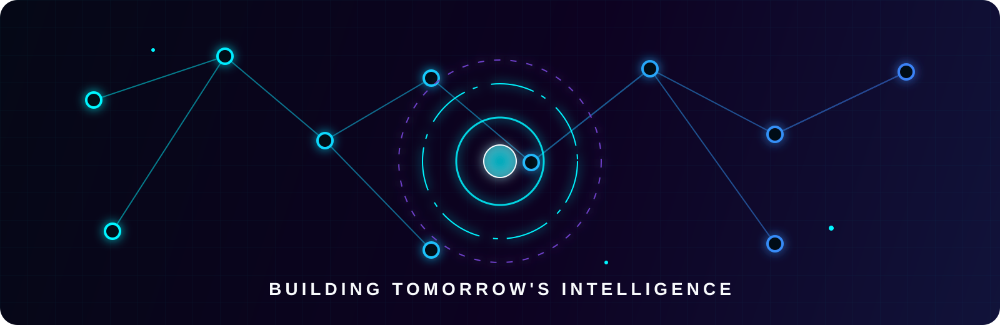
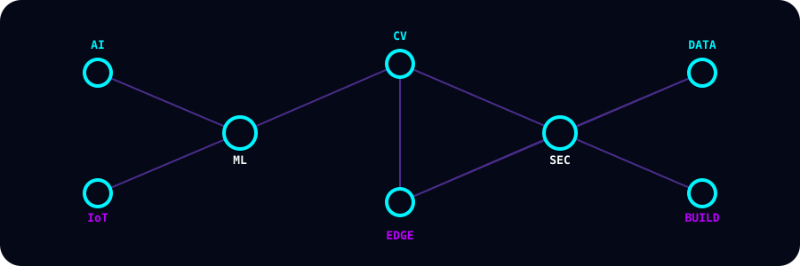

<!-- Sairaj Agawane | Ultra-premium GitHub profile README -->

<div align="center">



# ⚡ SAIRAJ AGAWANE

### AI Developer · ML Engineer · IoT Innovator · Future AI Architect


<br />

[](https://sairaj-six.vercel.app/)
[](https://github.com/SairajAgawane)
[](https://www.linkedin.com/in/sairaj-it)
[](mailto:sairajagawane2007@gmail.com)

<br />

[](https://github.com/SairajAgawane)
[](https://github.com/SairajAgawane?tab=followers)
[](https://github.com/SairajAgawane)

</div>


## 〔 ⚡ SYSTEM PROFILE — IDENTITY MODULE 〕

```python
class SairajAgawane:
    name = "Sairaj Agawane"
    location = "Maharashtra, India"
    education = "Diploma Engineering — Information Technology"
    institute = "SVPM's ITE, Malegaon (Bk)"
    current_role = "AI / ML / IoT Intern @ Air Guruji International"
    goal = "Become an AI Engineer & Cybersecurity Professional"
    mission = "Contribute to Industry 4.0 and digital transformation"

    interests = [
        "Artificial Intelligence", "Machine Learning",
        "Internet of Things", "Computer Vision",
        "Cybersecurity", "Software Development",
        "Industry 4.0", "Robotics",
    ]

    def philosophy(self):
        return (
            "Building innovative AI, IoT, and Cybersecurity projects "
            "that solve real-world challenges and improve everyday life."
        )
```

| Profile signal | Current information |
|---|---|
| 🎓 Education | Diploma Engineering — Information Technology, SVPM's ITE, Malegaon (Bk) |
| 💼 Experience | AI / ML / IoT Intern at Air Guruji International |
| 📍 Location | Maharashtra, India |
| 🎯 Goal | AI Engineer & Cybersecurity Professional |
| 🤝 Open to | Collaborations, internships, research, and open source |




## 〔 🧠 NEURAL CORE — AI & ML CAPABILITIES 〕

| Domain | Focus areas |
|---|---|
| 🤖 Artificial Intelligence | Natural Language Processing, computer vision with OpenCV, voice recognition, speech synthesis, conversational AI, intelligent command processing |
| 📊 Machine Learning | Supervised and unsupervised learning, predictive maintenance, anomaly detection, sensor analytics, feature engineering, ML deployment |
| 📡 IoT & Industry 4.0 | ESP32, ESP32-CAM, DHT11 and IR sensors, smart factory automation, QR maintenance monitoring, IoT dashboards, robotics |
| 🔐 Cybersecurity & Systems | Cybersecurity fundamentals, secure software architecture, system design, embedded systems, data analysis, full-stack development |

## 〔 💻 TECH ARSENAL — VERIFIED SKILLS 〕

### Programming and web


### AI, ML, and data


### IoT and embedded systems


### Data, tools, and security


## 〔 🚀 FLAGSHIP PROJECTS — DEPLOYED INTELLIGENCE 〕

### 🤖 JARVIS AI — Virtual Intelligence Core

A browser-based voice assistant with voice recognition, speech synthesis, supported voice commands, web search actions, and a futuristic interface.

[](https://github.com/SairajAgawane/Jarvis-AI)
[](https://jarvis-ai-wheat-ten.vercel.app/)

**Verified focus:** Web Speech API, Speech Synthesis, voice commands, Google/YouTube/Wikipedia actions, time/date responses, and a futuristic UI.

### ⚙️ Intelligent Predictive Maintenance System

An Industry 4.0 concept combining IoT hardware, sensor data, computer vision, QR maintenance monitoring, robotics, and predictive analytics.

[](https://sairaj-six.vercel.app/#projects)

**Showcase areas:** ESP32, ESP32-CAM, DHT11 and IR sensors, QR maintenance monitoring, AI/ML predictive analytics, IoT dashboards, robotics, and automation.

> No separate source repository or live deployment URL for this project is listed in the profile README.


## 〔 💼 EXPERIENCE — PROFESSIONAL JOURNEY 〕

### AI / ML / IoT Intern · Air Guruji International

The profile’s current experience record describes work across:

- AI, machine learning, and IoT systems;
- AI-powered solutions and automation tools;
- Industry 4.0 and smart manufacturing projects;
- cybersecurity application development; and
- digital transformation initiatives.

### Education

**Diploma Engineering — Information Technology**
SVPM's ITE, Malegaon (Bk)


## 〔 📊 PERFORMANCE METRICS — GITHUB TELEMETRY 〕

These cards are live-service views generated for the GitHub account and are not manually fabricated statistics.

<div align="center">


<br />


</div>

## 〔 🏆 ACHIEVEMENT MATRIX — UNLOCKED TROPHIES 〕

<div align="center">


</div>


## 〔 🌐 SYSTEM STATUS — CURRENT FOCUS 〕

```yaml
current_focus:
  - "AI / ML / IoT development"
  - "Computer Vision and OpenCV systems"
  - "Industry 4.0 smart factory research"
  - "Cybersecurity skills and certifications"

learning_queue:
  - "Transformer Architectures and Large Language Models"
  - "Federated Learning for IoT Edge Devices"
  - "Advanced Embedded AI (TinyML)"
  - "Quantum-Classical Hybrid AI"
  - "Generative AI and Diffusion Models"

ask_me_about:
  - "AI / ML Architecture"
  - "IoT and ESP32 Systems"
  - "OpenCV and Computer Vision"
  - "Industry 4.0 Automation"
  - "Cybersecurity Fundamentals"
```

No percentage values are presented here as current measurements; the topics represent the profile’s stated focus and learning interests.


## 〔 📡 ESTABLISH CONNECTION — OPEN CHANNELS 〕

<div align="center">

*Open for collaborations, internships, research, open source, and technical discussions.*

[](https://sairaj-six.vercel.app/)
[](https://github.com/SairajAgawane)
[](https://www.linkedin.com/in/sairaj-it)
[](mailto:sairajagawane2007@gmail.com)
[](https://drive.google.com/uc?export=download&id=1L56gm3WRBAG_XVXA6zkhJ2QKb5QLJWyE)

</div>

> “AI is not the future — it’s the infrastructure of now. Build it, own it, deploy it.”
> **— Sairaj Agawane, 2026**

## 〔 🛰️ SIGNAL TRACE — PROFILE FOOTER 〕

<div align="center">


**⚡ Engineered with precision by [Sairaj Agawane](https://sairaj-six.vercel.app/)**

*© 2026 Sairaj Agawane · Maharashtra, India · Building Tomorrow's Intelligence, Today*

</div>

